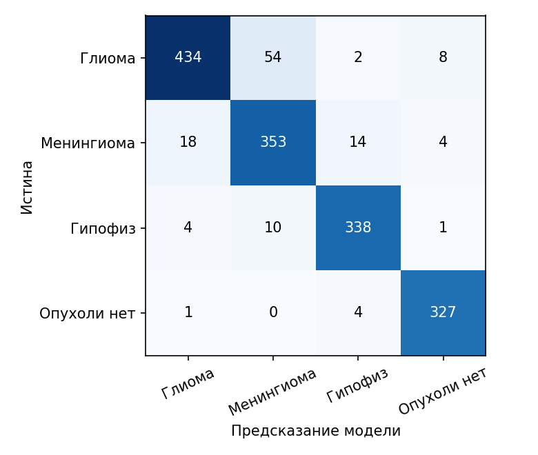

# Обнаружение и локализация опухолей головного мозга на МРТ — с честной оценкой

Хакатон «Медицина 2050», трек «Студенты», кейс «Здоровье под контролем ИИ».
Автор: Богдан Степура.

> Исследовательский прототип, **не медицинское изделие**. Результат — подсказка врачу, решение принимает врач.

## Как проверить за 3 шага (видеокарта не нужна)

1. Откройте демо: [](https://colab.research.google.com/github/blond7I/almazov-mri-tumor/blob/main/demo_colab.ipynb)
2. В Colab: **«Среда выполнения» → «Выполнить все»**. Если Colab предупредит, что блокнот не от Google, — «Всё равно запустить». Установка займёт 2–3 минуты.
3. В конце второй ячейки появится ссылка `https://….gradio.live` — откройте её, загрузите срез МРТ (JPG/PNG) или выберите пример внизу страницы.

> Демо переводится на финальную модель ResNet-50 19.10.2026; до этого оно работает на прежней EfficientNet-B0 (интерфейс тот же).

**Проверка на своих снимках:** ячейка 3 того же блокнота («Пакетная проверка») — укажите папку или `.zip`. Получите таблицу `batch_results.csv` (класс, вероятности, найден ли контур, площадь) и картинки с контуром. Если снимки разложены по папкам классов (`glioma/`, `meningioma/`, `pituitary/`, `notumor/` или `Глиома/`, `Менингиома/`, `Гипофиз/`, `Нет опухоли/`), ячейка сама посчитает точность, чувствительность и специфичность.

## Что сделано

1. **Аудит данных организаторов.** У **77%** снимков официального теста есть почти точная копия в обучающей части (корреляция ≥ 0.98 с учётом поворотов и отражений). Простой поиск похожего снимка без нейросети даёт на официальном тесте **93%**. Поэтому все модели оцениваются на собственном **групповом разбиении**: копии одного снимка, его аугментации и снимки одного пациента не попадают одновременно в обучение и тест.
2. **Классификатор** — наличие и тип опухоли (глиома / менингиома / гипофиз / нет опухоли). Сравнили 9 вариантов (архитектуры, аугментации, предобучение, разрешение, ансамбли); **по валидации выбран ResNet-50** (тест для выбора не использовался).
3. **Сегментация** (U-Net, ResNet34) — контур опухоли. Обучена на масках врачей из открытого набора Figshare (Cheng, 233 пациента). Внутри данных организаторов найдены снимки 231 из этих пациентов, маски перенесены на них.
4. **Прототип для врача** (Gradio): снимок → оценка наличия и типа → выделенная область → текстовое пояснение; пакетная проверка папки.
5. **Проверки честности и устойчивости**, независимая рецензия методики.

## Результаты (честный тест: группы не пересекаются с обучением)

| Задача | Метрика | Значение [95% ДИ] |
|---|---|---|
| Опухоль есть / нет | Чувствительность | **99.0%** [97.2–99.9] |
| | Специфичность* | **98.5%** [96.7–99.8] |
| | AUC | 0.998 |
| Тип опухоли (4 класса) | Accuracy | **92.4%** [89.4–95.3] |
| | macro-F1 | 0.927 [0.892–0.954] |
| | Глиомы распознано | 87.1% |
| Только новые пациенты Figshare (3 типа) | Accuracy | 94.0% |
| Уникальные снимки (без копий и аугментаций, 566) | Accuracy | 92.6% |
| Сегментация, 43 новых пациента (561 срез) | Dice средний / медиана | **0.79** [0.75–0.83] / 0.89 |
| | Dice по типам | менингиома 0.90 · гипофиз 0.84 · глиома 0.70 |
| Сегментация, снимки организаторов | Dice | 0.82 |
| Здоровые срезы | Ложный контур (правило демо)* | 0.3% (1 из 332) |

Классификатор — ResNet-50 (выбран по валидации). Бутстрэп 95% ДИ — по группам; n = 1572 тестовых снимка.
\* Нормальные снимки в данных — в основном другие режимы МРТ (T2/FLAIR), чем снимки с опухолью (T1 с контрастом). Специфичность нужно подтвердить на нормальных снимках T1 с контрастом.

**Почему не 96%.** EfficientNet-B0, обученная и проверенная на официальном разбиении, даёт 95.9%: на снимках с копией в обучении — 97.5%, без копии — 90.3%; та же модель на честном тесте — 87.8%. Опубликованный ориентир на Figshare: 96.6% при разбиении по снимкам и 88.5% по пациентам ([Badža & Barjaktarović, 2020](https://www.mdpi.com/2076-3417/10/6/1999)).




## Что пробовали (то же разбиение, меняем одну вещь)

| Вариант | Точность, 4 класса | Глиомы | val macro-F1 |
|---|---|---|---|
| EfficientNet-B0 (прежняя основная) | 87.8% | 74.5% | 0.919 |
| Ансамбль 3 обучений B0 | 90.1% | 79.9% | 0.936 |
| Ансамбль 6 сильных вариантов | 91.3% | 83.9% | 0.939 |
| Веса классов | 87.3% | 73.7% | 0.917 |
| 30 эпох вместо 15 | 90.8% | 84.3% | 0.934 |
| **ResNet-50 — выбрана** | **92.4%** | **87.1%** | **0.956** |
| Без аугментаций | 81.0% | 66.3% | 0.864 |
| Без предобучения на ImageNet | 69.1% | 49.4% | 0.710 |
| Вход 128 px вместо 256 | 84.3% | 72.7% | 0.873 |

Повторы обучения B0 (3 seed): 88.5 ± 0.7%. ResNet-50 обучен один раз (повторы не успели — дневной лимит видеокарты Colab). EfficientNet-B3: обучение разошлось (NaN), в сравнение не вошло.
Сегментация: без перенесённых масок организаторов Dice на их снимках 0.78 вместо 0.82; без здоровых снимков в обучении ложный контур на норме 62.3% вместо 0.3%.

## Проверки

| Проверка | Результат |
|---|---|
| Доля тест-снимков с копией в обучении | наш тест **0.7%**, официальный **77.4%** |
| «Подсмотреть ответ» у ближайшего снимка обучения (1-NN) | наш тест 63.6%, официальный 93.4% |
| Нулевой тест сопоставителя (Figshare содержит только опухоли) | 0 ложных совпадений со снимками «нет опухоли» из 1845 |
| Визуальная проверка 24 случайных пар у порога | все — один и тот же снимок (`figs/matcher_check.png`) |
| Обучение на перемешанных метках | 22% (ниже угадывания: метки теста не попадают в обучение через код) |
| Модель только по метаданным (размер, разрешение, яркость) | 60.7% при 31.7% у «самого частого класса»: источник частично выдаёт класс (ограничение данных) |
| Опухоль/норма внутри каждого типа файлов (B0) | AUC 0.99–1.00 (может отражать и разницу режимов МРТ — см. ограничения) |

## Ограничения

- **Глиомы** — самый трудный класс: распознано 87.1%, Dice контура 0.70; чаще всего путаются с менингиомой.
- **Нормальные снимки** в данных — в основном другие режимы МРТ и другие источники, чем опухоли. Отличать норму от опухоли именно на T1 с контрастом из той же клиники мы проверить не можем: таких нормальных снимков нет.
- **Низкое разрешение** (≤ 256 px): точность 90.2% против 94.0% у снимков > 400 px.
- **Разбиение по пациентам** гарантировано только для снимков, связанных с Figshare (~65%); для остальных — по копиям и аугментациям.
- Анализируются отдельные 2D-срезы JPG, а не DICOM-исследование целиком. Внешняя валидация на данных другой клиники не проводилась.

## Как устроено

```
Срез МРТ → предобработка (серый, квадрат, 256×256, контраст) → классификатор ResNet-50 (есть ли опухоль, тип)
                                                            → U-Net (контур опухоли) → пояснение для врача
```
Два режима решения на честном тесте:
- **скрининг** (классификатор, порог 0.5): чувствительность 99.0%, специфичность 98.5%*;
- **подтверждение** (найден контур U-Net): чувствительность 93.9%, специфичность 99.7%*.

## Файлы

| Файл | Что это |
|---|---|
| `demo_colab.ipynb` | Демо: скачивает обученные модели, запускает прототип и пакетную проверку папки снимков |
| `Almazov_MRI_v3.ipynb` | Основной пайплайн: данные → аудит → разбиение → обучение → оценка → проверки (с выводами) |
| `Almazov_MRI_experiments.ipynb` | Эксперименты на том же разбиении и выбор модели по валидации |
| `Almazov_MRI_final_eval_cpu.ipynb` | Финальная оценка выбранной модели (все метрики, ДИ) — работает без видеокарты |
| `Almazov_MRI_final_eval.ipynb` | То же на видеокарте + повторы обучения выбранной архитектуры |
| `results/` | Все метрики: `results_final.json` (финальная модель), `experiments_v1.json` (эксперименты), `*_v3.json` (основной пайплайн) |
| `figs/` | Графики и примеры |
| `examples/` | Примеры снимков для демо (из тестовой части) |
| `weights/` | Обученные модели (крупные файлы разбиты на части по ≤ 20 МБ — демо собирает их автоматически и проверяет контрольную сумму) |

Воспроизведение обучения: Colab с T4, `Almazov_MRI_v3.ipynb` → «Выполнить все» (~1 час), затем `Almazov_MRI_experiments.ipynb`. Нужен архив данных организаторов в Google Drive.

## Данные и лицензии

- Данные организаторов хакатона (12 064 снимка, 4 класса; доступно 9 150). По составу совпадает с Mendeley Data «Brain Tumor MRI Dataset», DOI 10.17632/zwr4ntf94j.5 (CC BY 4.0).
- Figshare: Cheng J. *brain tumor dataset*, DOI 10.6084/m9.figshare.1512427 (CC BY 4.0). Cheng et al., PLoS ONE 2015.
- Веса ImageNet: timm (ResNet-50, EfficientNet), segmentation-models-pytorch (ResNet34).

## Защита данных при внедрении (кратко)

Обработка внутри контура медорганизации (on-premise), обезличивание до анализа (152-ФЗ, приказ Роскомнадзора № 140 от 19.06.2025), разграничение доступа и журналирование (ПП РФ № 1119), без передачи снимков третьим лицам. Применение — как система поддержки решений врача, в соответствии с Кодексом этики применения ИИ в сфере охраны здоровья.
