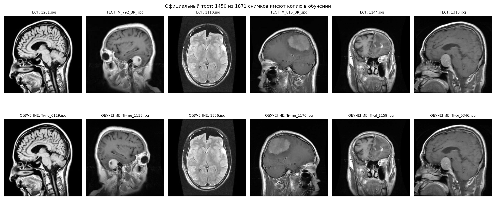
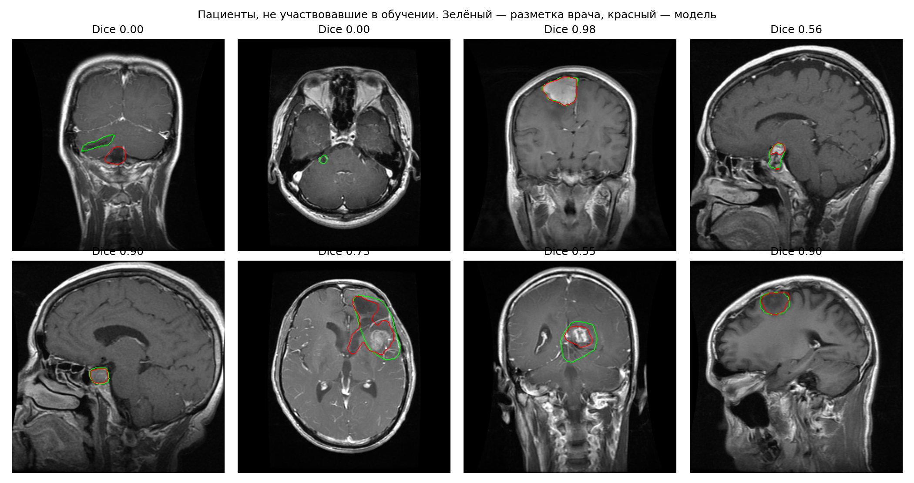
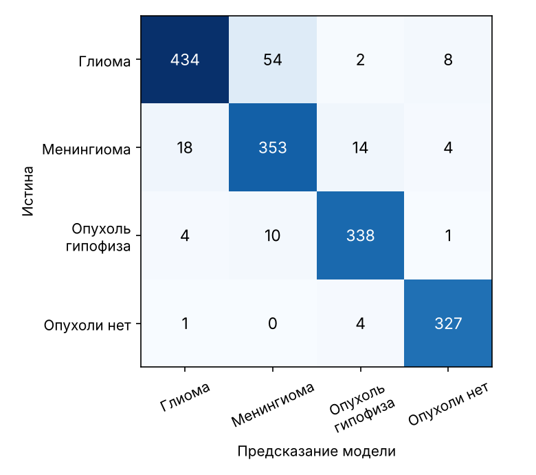

# Обнаружение и локализация опухолей головного мозга на МРТ — с честной оценкой

Хакатон «Медицина 2050», трек «Студенты», кейс «Здоровье под контролем ИИ».
Команда **InTeam**. Вопросы и уточнения: Telegram [@blond7I](https://t.me/blond7I).

> Исследовательский прототип, **не медицинское изделие**. Результат — подсказка врачу, решение принимает врач.

## Как проверить за 3 шага (видеокарта не нужна)

1. Откройте демо: [](https://colab.research.google.com/github/blond7I/almazov-mri-tumor/blob/main/demo_colab.ipynb)
2. В Colab: **«Среда выполнения» → «Выполнить все»**. Если Colab предупредит, что блокнот не от Google, — «Всё равно запустить». Установка займёт 2–3 минуты.
3. В конце первой ячейки появится ссылка `https://….gradio.live` — откройте её, загрузите срез МРТ (JPG/PNG) или выберите пример внизу страницы, нажмите «Анализ».

**Проверка на своих снимках:** ячейка 2 того же блокнота («Пакетная проверка») — укажите папку или `.zip`. Получите таблицу `batch_results.csv` (класс, вероятности, находки, флаги сомнений) и картинки с контуром. Если снимки разложены по папкам классов (`glioma/`, `meningioma/`, `pituitary/`, `notumor/` или `Глиома/`, `Менингиома/`, `Гипофиз/` или `Опухоль гипофиза/`, `Нет опухоли/`), ячейка сама посчитает точность, чувствительность и специфичность.

## Этап 2 (финал): граница, сомнения, проект заключения, проверка врачом

Протокол оценки зафиксирован в репозитории **до** получения результатов: [`docs/stage2_protocol.md`](docs/stage2_protocol.md).
Все пороги подобраны на валидации. Разбиение — то же, что на этапе 1. Исключение из протокола: вторая версия полосы неуверенности придумана **после** того, как первая провалилась на тесте, поэтому тест для неё использован повторно (подробно — ниже).

| Требование | Что сделано | Результат на тесте |
|---|---|---|
| 3.1 Граница | ансамбль 4 моделей U-Net (модель этапа 1 + 3 новых обучения) | Dice **0.805** против 0.789 у этапа 1; прирост +0.013 [+0.005; +0.021] по пациентам |
| 3.1 Неуверенная граница | жёлтая полоса: контур ∪ участки, где хотя бы одна модель видит опухоль, + кольцо 2 пикс.; ширина подобрана conformal risk control на 38 пациентах валидации | внешний край охватывает в среднем **91%** опухоли [85–95%] (цель ≥ 90%; без полосы — 80%); это среднее по пациентам, а не гарантия для каждого: у 23% пациентов охват ниже 90%. Полоса на 19% уже простого кольца с тем же уровнем |
| 3.1 Ядро/отёк (доп.) | контур ≈ видимая на T1 с контрастом часть образования; отдельный модуль по T1c+FLAIR (BraTS) — в работе | — |
| 3.2 Надёжность | калибровка температурой, отказ при низкой уверенности, зоны дополнительного просмотра, фильтр входа (режим МРТ, плоскость, КТ, «не тот» снимок) | отложив 15% наименее уверенных — ловим **66%** ошибок (точность на остальных 97%); провал контура распознаётся с AUROC **0.90** (базовые линии 0.68–0.73); срезы без контура при опухоли — 14 из 14 отмечены «смотрите весь срез» |
| 3.3 Проект заключения | детерминированный шаблон без языковой модели: исходные данные → описание → заключение (проект) → сомнения → ограничения → подпись врача; DICOM → мм и сторона пациента | — |
| 3.4 Проверка врачом | рабочее место врача: порог, удаление/добавление находок, кисть, пересчёт текста, проверка «текст ↔ анализ», сохранение PDF + журнал правок + маска | сессия с врачом — 15–17.11 |
| 3.5 Проверка | до/после на том же тесте, галерея ошибок, 92 по-настоящему новых снимка из полного архива организаторов | на новых снимках точность 75–78% (против 92% на тесте). По классам: опухоль заподозрена в 30 из 36 случаев (83%), но тип глиомы верен лишь в 7 из 17 (41%), контур найден в 61% опухолей; ложная тревога — у 1 из 56 здоровых. Система сама просит проверки вдвое чаще, чем на тесте (30% снимков против 15%), и помечает 65% своих ошибок |

**Что не получилось (честно):**
- Первая версия полосы (порог вероятности 0.2) ловила пропущенную опухоль хуже простого кольца той же площади и не давала гарантии — заменена второй (семейство и ширина выбраны на валидации, но сама идея второй версии появилась после просмотра теста); обе версии в [`results/stage2/`](results/stage2/). Проверка полосы на чужих данных (T1 с контрастом из BraTS, срезы без черепа) — **провал вне области обучения**: контур найден лишь на 17% срезов с опухолью, Dice 0.09, внешний край полосы охватывает 69% опухоли вместо 91%, фильтр входа отклонил только треть таких срезов ([`results/stage2/extras.json`](results/stage2/extras.json), `brats_band`). Вывод: в новой клинике систему сначала проверяют и перекалибровывают на её данных.
- Конформные множества диагнозов не держат 90% на тесте (LAC — 86%) или слишком широкие (APS — 2.5 класса из 4): основной механизм — отказ при низкой уверенности.
- **Перекос данных:** снимки с опухолью почти все — T1 с контрастом, а среди здоровых T1 лишь 28% (остальные T2, FLAIR и даже КТ). Специфичность на здоровых T1 — **86%** (18 из 21, ДИ ≈ 65–95%), на T2/FLAIR/КТ — 100%. Режим и плоскость размечены по описанию набора Figshare (T1c) и визуально ИИ-ассистентом, а не врачом; выборочная проверка врачом запланирована. Поэтому T2/FLAIR/КТ система теперь отклоняет как «вне области применения», а не отвечает «опухоли нет». Подробности: [`results/stage2/sequence_specificity.json`](results/stage2/sequence_specificity.json).

**Внешние проверки и что добавили после 8.11:**
- **BRISC 2025** (Fateh et al., *Scientific Data*, 2026; 6000 срезов T1, контуры проверены врачами). Каждый снимок сопоставлен с нашим разбиением (корреляция ≥ 0.98 с учётом поворотов и отражений); снимки из нашего обучения в проверке не участвуют. На 735 снимках нашего теста: тип верен в **93.6%**, Dice с контурами врачей BRISC **0.79** (глиома 0.72, менингиома 0.84, гипофиз 0.79). На 1147 здоровых снимках, которых в наших данных нет: отказ — 187, ложная тревога классификатора — **81 из 960 (8.4%)**. Наша разметка режима МРТ совпала с BRISC на 267 из 270 общих снимков. Файлы: [`results/stage2/brisc_eval.json`](results/stage2/brisc_eval.json), [`brisc_map.csv`](results/stage2/brisc_map.csv).
- **Три уровня ответа о наличии**: «найдено» — только когда согласны классификатор и контур; «нужен просмотр» — согласен один; «не найдено». Здоровые BRISC: «найдено» **0.8%** (8 из 960), «нужен просмотр» 8.2%; здоровые теста организаторов: «найдено» 0 из 29 (было 3 из 29). Опухоли (723 снимка теста, размеченные BRISC): «найдено» 98.5%, «нужен просмотр» 1.5%, без пометки — 0. Честно: правило без подбираемых параметров, но придумано после BRISC — независимая проверка в следующих прогонах ([`tools/triage_levels.py`](tools/triage_levels.py), [`results/stage2/triage_levels.json`](results/stage2/triage_levels.json)).
- **Исследование целиком (серия DICOM)**: вкладка рабочего места — по каждому срезу вероятность опухоли и контур, диапазон срезов с находкой, оценка объёма (сумма площадей × шаг; ориентир — модели обучены на отдельных срезах), ключевой срез анализируется полным ансамблем ([`src/almazov/series.py`](src/almazov/series.py)).
- **«Куда смотрел классификатор»**: слой с тепловой картой (Grad-CAM ансамбля) и проверка «сотрём найденную область — что изменится» ([`src/almazov/explain.py`](src/almazov/explain.py)). Проверка на тесте с масками экспертов — [`notebooks/stage2_explain.ipynb`](notebooks/stage2_explain.ipynb), правила записаны до запуска.
- **Эксперименты с обучением** (правила приёма записаны до запуска, [`docs/stage2_protocol.md`](docs/stage2_protocol.md)): B — BRISC + искажения качества снимка (BigAug-подобные), C — здоровые T1 из BRISC в обучении классификатора.

Код этапа 2 — пакет [`src/almazov`](src/almazov) (анализ, заключение, интерфейс, оценка); обучение и оценка — ноутбуки в [`notebooks/`](notebooks/) (Kaggle).

**Видео демо (85 с):** [`media/demo_stage2.mp4`](media/demo_stage2.mp4) — глиома: контур, полоса сомнений, порог, проверка текста, сохранение; снимок T2 и КТ: отказ.

### Офлайн-демо на ноутбуке (Windows, без интернета)
1. Скачайте репозиторий целиком (Code → Download ZIP, ≈ 450 МБ вместе с весами) и распакуйте.
2. Один раз при хорошем интернете: `tools\offline\install_windows.bat` (ставит Python-окружение и проверяет модели на примерах).
3. Дальше без интернета: `tools\offline\run_demo.bat` — рабочее место врача откроется в браузере (http://127.0.0.1:7860).

## Этап 1: что сделано

1. **Аудит данных организаторов.** У **77%** снимков официального теста есть почти точная копия в обучающей части (корреляция ≥ 0.98 с учётом поворотов и отражений). Простой поиск похожего снимка без нейросети даёт на официальном тесте **93%**. Поэтому все модели оцениваются на собственном **групповом разбиении**: копии одного снимка, его аугментации и снимки одного пациента не попадают одновременно в обучение и тест.
2. **Классификатор** — наличие и тип опухоли (глиома / менингиома / опухоль гипофиза / нет опухоли). Сравнили 9 вариантов (архитектуры, аугментации, предобучение, разрешение, ансамбли); **по валидации выбран ResNet-50** (тест для выбора не использовался).
3. **Сегментация** (U-Net, ResNet34) — контур опухоли. Обучена на масках врачей из открытого набора Figshare (Cheng, 233 пациента). Внутри данных организаторов найдены снимки 231 из этих пациентов, маски перенесены на них.
4. **Прототип для врача** (Gradio): снимок → оценка наличия и типа → выделенная область → текстовое пояснение; пакетная проверка папки.
5. **Проверки честности и устойчивости**, независимая рецензия методики.

## Результаты (честный тест: группы не пересекаются с обучением)

| Задача | Метрика | Значение [95% ДИ] |
|---|---|---|
| Опухоль есть / нет | Чувствительность | **99.0%** [97.2–99.9] |
| | Специфичность* | **98.5%** [96.7–99.8] |
| | AUC | 0.998 |
| Тип опухоли (4 класса) | Accuracy | **92.4%** [89.4–95.3] |
| | macro-F1 | 0.927 [0.892–0.954] |
| | Глиомы распознано | 87.1% |
| Только новые пациенты Figshare (3 типа) | Accuracy | 94.0% |
| Уникальные снимки (без копий и аугментаций, 566) | Accuracy | 92.6% |
| Сегментация, 43 новых пациента (561 срез) | Dice средний / медиана | **0.79** [0.75–0.83] / 0.89 |
| | Dice по типам | менингиома 0.90 · опухоль гипофиза 0.84 · глиома 0.70 |
| Сегментация, снимки организаторов | Dice | 0.82 |
| Здоровые срезы | Ложный контур (правило демо)* | 0.3% (1 из 332) |

Классификатор — ResNet-50 (выбран по валидации). Бутстрэп 95% ДИ — по группам; n = 1572 тестовых снимка.
\* Нормальные снимки в данных — в основном другие режимы МРТ (T2/FLAIR), чем снимки с опухолью (T1 с контрастом). Специфичность нужно подтвердить на нормальных снимках T1 с контрастом.

**Почему не 96%.** EfficientNet-B0, обученная и проверенная на официальном разбиении, даёт 95.9%: на снимках с копией в обучении — 97.5%, без копии — 90.3%; та же модель на честном тесте — 87.8%. Опубликованный ориентир на Figshare: 96.6% при разбиении по снимкам и 88.5% по пациентам ([Badža & Barjaktarović, 2020](https://www.mdpi.com/2076-3417/10/6/1999)).





## Что пробовали (то же разбиение, меняем одну вещь)

| Вариант | Точность, 4 класса | Глиомы | val macro-F1 |
|---|---|---|---|
| EfficientNet-B0 (прежняя основная) | 87.8% | 74.5% | 0.919 |
| Ансамбль 3 обучений B0 | 90.1% | 79.9% | 0.936 |
| Ансамбль 6 сильных вариантов | 91.3% | 83.9% | 0.939 |
| Веса классов | 87.3% | 73.7% | 0.917 |
| 30 эпох вместо 15 | 90.8% | 84.3% | 0.934 |
| **ResNet-50 — выбрана** | **92.4%** | **87.1%** | **0.956** |
| Без аугментаций | 81.0% | 66.3% | 0.864 |
| Без предобучения на ImageNet | 69.1% | 49.4% | 0.710 |
| Вход 128 px вместо 256 | 84.3% | 72.7% | 0.873 |

Повторы обучения B0 (3 seed): 88.5 ± 0.7%. ResNet-50 обучен один раз (повторы не успели — дневной лимит видеокарты Colab). EfficientNet-B3: обучение разошлось (NaN), в сравнение не вошло.
Сегментация: без перенесённых масок организаторов Dice на их снимках 0.78 вместо 0.82; без здоровых снимков в обучении ложный контур на норме 62.3% вместо 0.3%.

## Проверки

| Проверка | Результат |
|---|---|
| Доля тест-снимков с копией в обучении | наш тест **0.7%**, официальный **77.4%** |
| «Подсмотреть ответ» у ближайшего снимка обучения (1-NN) | наш тест 63.6%, официальный 93.4% |
| Нулевой тест сопоставителя (Figshare содержит только опухоли) | 0 ложных совпадений со снимками «нет опухоли» из 1845 |
| Визуальная проверка 24 случайных пар у порога | все — один и тот же снимок (`figs/matcher_check.png`) |
| Обучение на перемешанных метках | 22% (ниже угадывания: метки теста не попадают в обучение через код) |
| Модель только по метаданным (размер, разрешение, яркость) | 60.7% при 31.7% у «самого частого класса»: источник частично выдаёт класс (ограничение данных) |
| Опухоль/норма внутри каждого типа файлов (B0) | AUC 0.99–1.00 (может отражать и разницу режимов МРТ — см. ограничения) |

## Ограничения

- **Глиомы** — самый трудный класс: распознано 87.1%, Dice контура 0.70; чаще всего путаются с менингиомой.
- **Нормальные снимки** в данных — в основном другие режимы МРТ и другие источники, чем опухоли. Отличать норму от опухоли именно на T1 с контрастом из той же клиники мы проверить не можем: таких нормальных снимков нет.
- **Низкое разрешение** (≤ 256 px): точность 90.2% против 94.0% у снимков > 400 px.
- **Разбиение по пациентам** гарантировано только для снимков, связанных с Figshare (~65%); для остальных — по копиям и аугментациям.
- Анализируются отдельные 2D-срезы JPG, а не DICOM-исследование целиком. Внешняя валидация на данных другой клиники не проводилась.

## Как устроено

```
Срез МРТ → предобработка (серый, квадрат, 256×256, контраст) → классификатор ResNet-50 (есть ли опухоль, тип)
                                                            → U-Net (контур опухоли) → пояснение для врача
```
Два режима решения на честном тесте:
- **скрининг** (классификатор, порог 0.5): чувствительность 99.0%, специфичность 98.5%*;
- **подтверждение** (найден контур U-Net): чувствительность 93.9%, специфичность 99.7%*.

## Файлы

| Файл | Что это |
|---|---|
| `presentation/Трек_Студенты_InTeam.pdf` | Презентация решения (PDF-копия; основной файл — PPTX) |
| `screenshots/` | Скриншоты работающего прототипа (ResNet-50) |
| `demo_colab.ipynb` | Демо этапа 2: рабочее место врача (контур, полоса неуверенности, зоны просмотра, проект заключения, сохранение PDF) и пакетная проверка |
| `demo_colab_stage1.ipynb` | Демо этапа 1 (как было сдано) |
| `Almazov_MRI_v3.ipynb` | Основной пайплайн: данные → аудит → разбиение → обучение → оценка → проверки (с выводами) |
| `Almazov_MRI_experiments.ipynb` | Эксперименты на том же разбиении и выбор модели по валидации |
| `Almazov_MRI_final_eval_cpu.ipynb` | Финальная оценка выбранной модели (все метрики, ДИ) — работает без видеокарты |
| `Almazov_MRI_final_eval.ipynb` | То же на видеокарте + повторы обучения выбранной архитектуры |
| `results/` | Все метрики: `results_final.json` (финальная модель), `experiments_v1.json` (эксперименты), `*_v3.json` (основной пайплайн) |
| `figs/` | Графики и примеры |
| `examples/` | Примеры снимков для демо (из тестовой части) |
| `weights/` | Обученные модели (крупные файлы разбиты на части по ≤ 20 МБ — демо собирает их автоматически и проверяет контрольную сумму) |

Воспроизведение обучения: Colab с T4, `Almazov_MRI_v3.ipynb` → «Выполнить все» (~1 час), затем `Almazov_MRI_experiments.ipynb`. Нужен архив данных организаторов в Google Drive.

## Данные и лицензии

- Данные организаторов хакатона (12 064 снимка, 4 класса; доступно 9 150). По составу совпадает с Mendeley Data «Brain Tumor MRI Dataset», DOI 10.17632/zwr4ntf94j.5 (CC BY 4.0).
- Figshare: Cheng J. *brain tumor dataset*, DOI 10.6084/m9.figshare.1512427 (CC BY 4.0). Cheng et al., PLoS ONE 2015.
- Веса ImageNet: timm (ResNet-50, EfficientNet), segmentation-models-pytorch (ResNet34).

## Защита данных при внедрении (кратко)

Обработка внутри контура медорганизации (on-premise), обезличивание до анализа (152-ФЗ, приказ Роскомнадзора № 140 от 19.06.2025), разграничение доступа и журналирование (ПП РФ № 1119), без передачи снимков третьим лицам. Применение — как система поддержки решений врача, в соответствии с Кодексом этики применения ИИ в сфере охраны здоровья.
