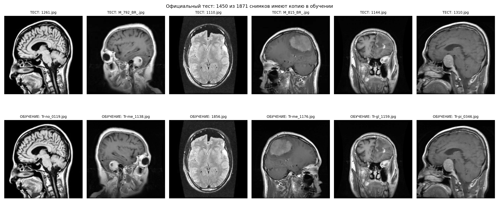
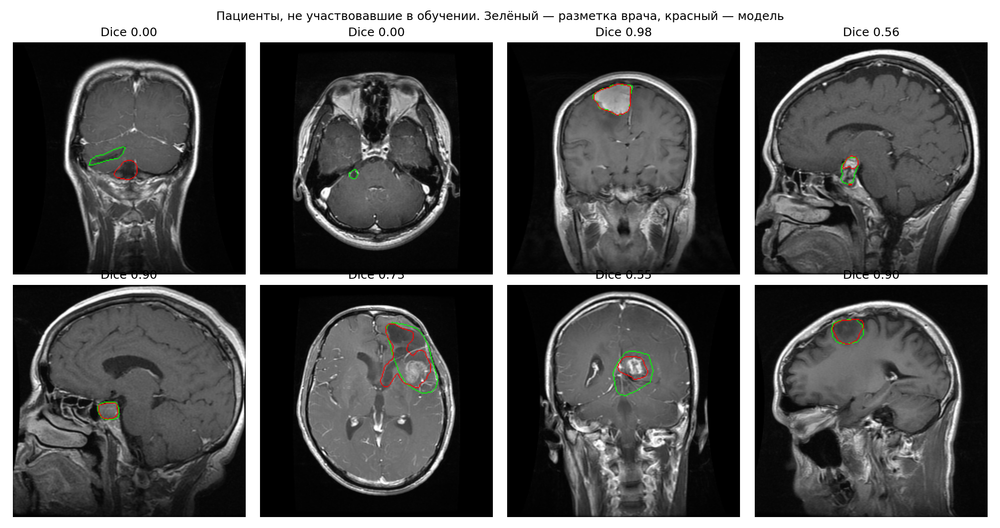
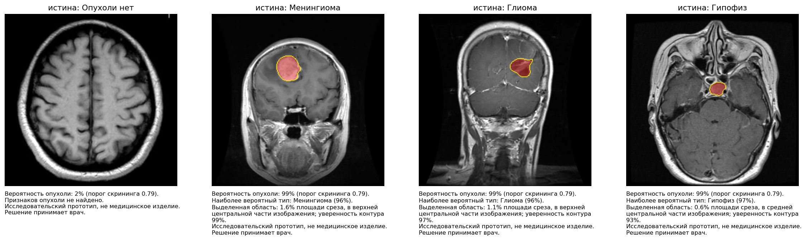

# Обнаружение и локализация опухолей головного мозга на МРТ — с честной оценкой

Хакатон «Медицина 2050», трек «Студенты», кейс «Здоровье под контролем ИИ».
Автор: Богдан Степура.

**Демо за 2–3 минуты:** [](https://colab.research.google.com/github/blond7I/almazov-mri-tumor/blob/main/demo_colab.ipynb) → «Среда выполнения» → «Выполнить все» → откройте ссылку `gradio.live` и загрузите срез МРТ (или выберите пример внизу страницы). Видеокарта не нужна.

**Проверка на своих снимках:** в том же блокноте ячейка 3 «Пакетная проверка» — укажите папку или `.zip` со снимками. Получите таблицу `batch_results.csv` (класс, вероятности, найден ли контур, площадь) и картинки с контуром. Если снимки лежат в папках классов (`glioma/`, `notumor/`, `Глиома/`, `Нет опухоли/` …), ячейка сама посчитает точность, чувствительность и специфичность.

> Исследовательский прототип, **не медицинское изделие**. Результат — подсказка врачу, решение принимает врач.

## Что сделано

1. **Аудит данных организаторов.** У **77%** снимков официального теста есть почти идентичная копия в обучающей части (корреляция ≥ 0.98 с учётом поворотов и отражений). Без нейросети, простым поиском похожего снимка, на официальном тесте получается **93%** точности. Поэтому мы оцениваем модели на собственном **групповом разбиении**: копии одного снимка и снимки одного пациента не попадают одновременно в обучение и тест.
2. **Классификатор** (EfficientNet-B0): наличие и тип опухоли (глиома / менингиома / гипофиз / нет опухоли).
3. **Сегментация** (U-Net, ResNet34): контур опухоли. Обучена на масках врачей из открытого набора Figshare (Cheng, 233 пациента). Внутри данных организаторов найдены снимки 231 из этих пациентов, маски перенесены на них.
4. **Прототип для врача** (Gradio): загрузка снимка → оценка наличия и типа → выделенная область → текстовое пояснение.
5. **Проверки честности** и **независимая рецензия** методики (подробности ниже).

## Результаты (честный тест: группы не пересекаются с обучением)

| Задача | Метрика | Значение [95% ДИ] |
|---|---|---|
| Опухоль есть / нет | Чувствительность | **98.1%** [96.2–99.4] |
| | Специфичность | **97.3%** [94.4–99.1] |
| | AUC | 0.994 |
| Тип опухоли (4 класса) | Accuracy | **87.8%** [82.4–92.4] |
| | macro-F1 | 0.886 [0.834–0.923] |
| Только новые пациенты Figshare (3 типа) | Accuracy | 89.3% |
| Сегментация, 43 новых пациента (561 срез) | Dice средний / медиана | **0.79** [0.75–0.83] / 0.89 |
| | Dice по типам | менингиома 0.90 · гипофиз 0.84 · глиома 0.70 |
| Сегментация, снимки организаторов (990) | Dice | 0.82 |
| Здоровые срезы | Ложный контур (как в демо) | 0.3% (1 из 332) |

Бутстрэп 95% ДИ — по группам. n = 1572 тестовых снимка, из них 566 уникальных (без копий и аугментаций).

**Почему не 96%.** Та же архитектура, обученная и проверенная на официальном разбиении, даёт 95.9%. На снимках, у которых есть копия в обучении, — 97.5%, на снимках без копии — 90.3%. Опубликованный ориентир: на Figshare одна сеть даёт 96.6% при разбиении по снимкам и 88.5% при разбиении по пациентам ([Badža & Barjaktarović, 2020](https://www.mdpi.com/2076-3417/10/6/1999)). Наши 89.3% на новых пациентах (3 типа) сопоставимы с этой оценкой: это не рекорд, а честно измеренный уровень.





## Проверки

| Проверка | Результат |
|---|---|
| Доля тест-снимков с копией в обучении | наш тест **0.7%**, официальный **77.4%** |
| «Подсмотреть ответ» у ближайшего снимка обучения (1-NN) | наш тест 63.6%, официальный 93.4% |
| Нулевой тест сопоставителя (Figshare содержит только опухоли) | 0 ложных совпадений со снимками «нет опухоли» из 1845 |
| Визуальная проверка 24 случайных пар у порога | все — один и тот же снимок (`figs/matcher_check.png`) |
| Обучение на перемешанных метках | 22% (ниже угадывания: метки теста не попадают в обучение через код) |
| Модель только по метаданным (размер, разрешение, яркость) | 60.7% при 31.7% у «самого частого класса»: источник частично выдаёт класс (ограничение данных) |
| Опухоль/норма внутри каждого типа файлов | AUC 0.99–1.00 (может отражать и разницу режимов МРТ — см. ограничения) |

## Ограничения (критичные ошибки и что с ними делать)

- **Глиомы**: распознаются хуже (recall 74.5%, Dice 0.70), чаще путаются с менингиомой. Что делать: анализ соседних срезов, больше примеров глиом.
- **Нормальные снимки** в данных — в основном другие режимы МРТ (T2/FLAIR) и другие источники, чем опухоли (T1 с контрастом). Отличать норму от опухоли именно на T1 с контрастом из той же клиники мы проверить не можем: таких нормальных снимков нет. При закрашивании опухоли модели всё ещё реагируют на окружающие изменения. Что делать: дообучение на нормальных исследованиях целевого протокола.
- **Низкое разрешение** (≤ 256 px): точность 84.6% против 89.9% у снимков > 400 px.
- **Разбиение по пациентам** гарантировано только для снимков, связанных с Figshare (~65%). Для остальных — по копиям и аугментациям.
- **Шум разметки**: 24 пары почти одинаковых снимков (корреляция ≥ 0.98) с разными метками.
- Анализируются отдельные 2D-срезы JPG, а не DICOM-исследование целиком. Внешняя валидация на данных другой клиники не проводилась.

## Как устроено

```
Срез МРТ → предобработка (серый, квадрат, 256×256, контраст) → классификатор (есть ли опухоль, тип)
                                                            → U-Net (контур опухоли) → пояснение для врача
```
Два режима решения на честном тесте:
- **скрининг** (классификатор): чувствительность 98.2%, специфичность 97.3%;
- **подтверждение** (найден контур): чувствительность 93.9%, специфичность 99.7%.

## Файлы

| Файл | Что это |
|---|---|
| `demo_colab.ipynb` | Демо: скачивает обученные модели, запускает прототип и пакетную проверку папки со снимками |
| `Almazov_MRI_v3.ipynb` | Полный пайплайн: данные → аудит → разбиение → обучение → оценка → проверки (с выводами) |
| `Almazov_MRI_experiments.ipynb` | Эксперименты на том же разбиении: повторы обучения (seed), другие архитектуры, без аугментаций, без предобучения, 128 px; сегментация без перенесённых масок и без пустых масок |
| `results/*.json`, `results/summary_v3.md` | Все метрики (актуальный порог скрининга и ложные контуры — в `verification_v3.json` и `review_checks_v3.json`) |
| `figs/` | Графики и примеры |
| `examples/` | Примеры снимков для демо (из тестовой части) |
| `weights/` | Обученные модели: `cls_v3_best.pt` (16 МБ) и `seg_v3_best.pt` (98 МБ, разбит на 5 частей по ≤ 20 МБ — демо собирает его автоматически и проверяет контрольную сумму) |

Воспроизведение обучения: Colab с T4, `Almazov_MRI_v3.ipynb` → «Выполнить все» (~1 час). Нужен архив данных организаторов в Google Drive.

## Данные и лицензии

- Данные организаторов хакатона (12 064 снимка, 4 класса; доступно 9 150). По составу совпадает с Mendeley Data «Brain Tumor MRI Dataset», DOI 10.17632/zwr4ntf94j.5 (CC BY 4.0).
- Figshare: Cheng J. *brain tumor dataset*, DOI 10.6084/m9.figshare.1512427 (CC BY 4.0). Cheng et al., PLoS ONE 2015.
- Веса ImageNet: timm (EfficientNet-B0), segmentation-models-pytorch (ResNet34).

## Защита данных при внедрении (кратко)

Обработка внутри контура медорганизации (on-premise), обезличивание до анализа (152-ФЗ, приказ Роскомнадзора № 140 от 19.06.2025), разграничение доступа и журналирование (ПП РФ № 1119), без передачи снимков третьим лицам. Применение — как система поддержки решений врача, в соответствии с Кодексом этики применения ИИ в сфере охраны здоровья.
